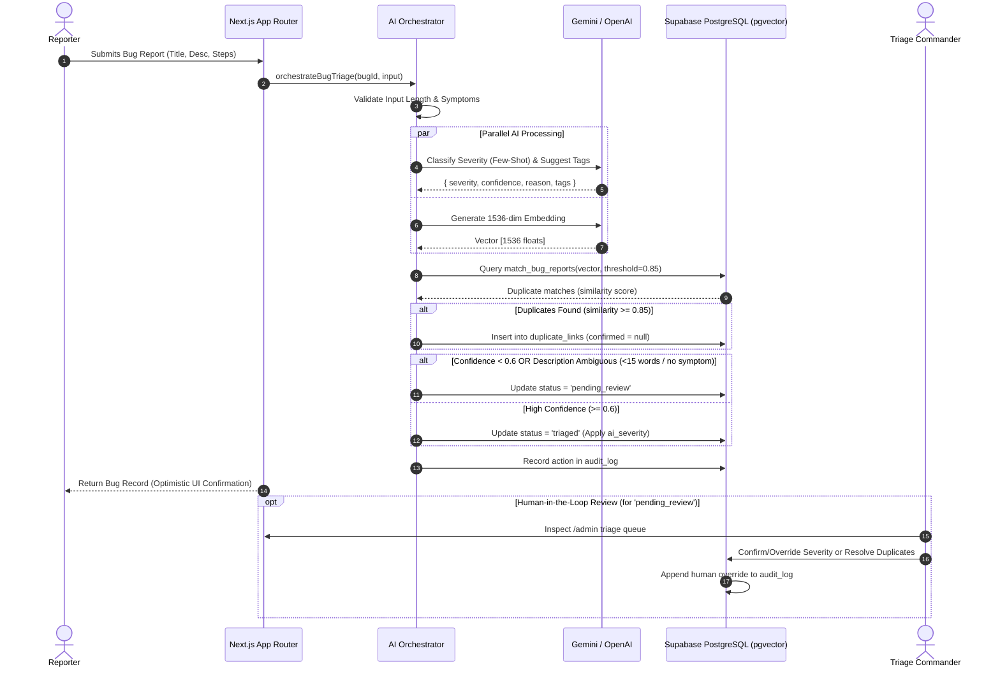

# AI-Assisted Software Bug Reporting and Triage System

An enterprise-grade, academic research prototype designed for automated software bug intake, few-shot severity classification, semantic duplicate detection via high-dimensional vector embeddings (`pgvector`), and human-in-the-loop triage management.

---

## 1. System Architecture

The system implements a decoupled 4-layer architecture ensuring high fault tolerance, auditability, and modularity:

```mermaid
graph TD
    subgraph Layer 1: Client UI [Next.js App Router]
        A["/report (Reporter Intake)"]
        B["/bugs (Engineering Queue)"]
        C["/admin (Triage Command)"]
    end

    subgraph Layer 2: API & Middleware [Next.js Server]
        D["/api/bugs (CRUD & Triage Trigger)"]
        E["/api/admin/triage (Batch Actions)"]
        M["Middleware (Supabase Auth & RLS)"]
    end

    subgraph Layer 3: AI Orchestration Service [lib/ai-orchestrator.ts]
        F["1. Input Validation & Length Guard"]
        G["2. Few-Shot Severity Classifier (Gemini/OpenAI)"]
        H["3. Multi-Label Tag Classifier"]
        I["4. 1536-dim Embedding Generator"]
        J["5. Semantic Cosine Deduplication (>= 0.85)"]
        K["6. Ambiguity Guard & Confidence Routing (< 0.6)"]
    end

    subgraph Layer 4: Storage & AI Providers
        L[("Supabase PostgreSQL + pgvector")]
        P["External LLMs (Gemini 3.6 Flash / GPT-4o-mini)"]
        R["Audit Log (Append-Only)"]
    end

    A --> D
    B --> D
    C --> E
    D --> M
    E --> M
    M --> F
    F --> G
    F --> H
    F --> I
    G <--> P
    H <--> P
    I <--> P
    I --> J
    J <--> L
    G --> K
    K --> L
    K --> R
```



### Layer Responsibilities

1. **Client Presentation Layer (`app/`)**:
   - `/report`: Interactive defect intake form with real-time validation and reproduction step guidelines.
   - `/bugs` & `/bugs/[id]`: Engineering dashboard displaying classified severity, suggested tags, duplicate clusters, and triage status.
   - `/admin`: Command dashboard for human triage engineers to review low-confidence tickets, confirm/reject duplicates, and override classifications.
2. **Application & Security Layer (`proxy.ts`, `app/api/`)**:
   - Role-Based Access Control (RBAC) via Supabase SSR Authentication (`reporter`, `developer`, `admin`).
   - RESTful endpoints handling optimistic UI updates and atomic transaction coordination.
3. **AI Orchestration Service (`lib/ai-orchestrator.ts`)**:
   - **Input Validation**: Rejects malformed titles ($<5$ chars) and descriptions ($<10$ chars) before triggering external APIs.
   - **Few-Shot Severity Classifier**: Evaluates symptoms against 4 calibrated exemplars into `Critical`, `High`, `Medium`, or `Low`.
   - **Semantic Deduplication**: Generates 1536-dimensional embeddings and executes vector similarity queries against existing defects using cosine distance ($1 - \text{cosine\_distance}$). Matches $\ge 0.85$ are flagged in `duplicate_links`.
   - **Ambiguity Guard**: Flags descriptions under 15 words or lacking symptom keywords (`crash`, `leak`, `segfault`, etc.) into `pending_review`.
   - **Fault-Tolerant Fallback**: Catches API timeouts, rate-limits, and quota exhaustion, falling back to deterministic keyword heuristics without blocking bug creation (ticket marked `pending_triage`).
4. **Persistence & Vector Layer (`supabase/migrations/`)**:
   - Native `pgvector` indexing with Cosine Distance RPC functions.
   - Row Level Security (RLS) enforcing multi-tenant isolation.
   - Immutable, append-only `audit_log` tracking every automated decision and human override.

---

## 2. End-to-End Triage Workflow



---

## 3. Empirical Research Pipeline & Evaluation Methodology

The repository includes a reproducible 4-stage empirical research pipeline evaluating LLM triage performance across **676 real-world open-source defects** (Eclipse Platform/JDT/CDT and Mozilla Firefox/Core/Thunderbird/Bugzilla):

```
                       ┌──────────────────────────────────────────────────┐
                       │ Stage 1: Dataset Construction                    │
                       │ 676 Disjoint Bugs (All >= 15 words)              │
                       └─────────────────────────┬────────────────────────┘
                                                 ▼
                       ┌──────────────────────────────────────────────────┐
                       │ Stage 2: Prediction Caching                      │
                       │ Cached LLM & Rule Baseline (scripts/predictions) │
                       └─────────────────────────┬────────────────────────┘
                                                 ▼
                       ┌──────────────────────────────────────────────────┐
                       │ Stage 3: Dev-Only Ensemble Tuning (N=148)        │
                       │ Strict Firewall: Tunes Critical Override Rule    │
                       │ Output: scripts/ensemble-config.json             │
                       └─────────────────────────┬────────────────────────┘
                                                 ▼
                       ┌──────────────────────────────────────────────────┐
                       │ Stage 4: Frozen Held-Out Evaluation (N=528)      │
                       │ Track A: Balanced Held-Out (N=148)               │
                       │ Track B: Natural Imbalance Pooled (N=380)        │
                       │ Tests: McNemar Exact Test & Cochran's Q          │
                       └──────────────────────────────────────────────────┘
```

### Dataset Splits

| Dataset Split | File | Track / Purpose | Bug Count | Distribution ($\text{C / H / M / L}$) |
| :--- | :--- | :--- | :---: | :---: |
| **Eclipse Dev** | `scripts/eclipse-dev.json` | Dev / Tuning (Balanced) | 48 | 12 / 12 / 12 / 12 (25% each) |
| **Mozilla Dev** | `scripts/mozilla-dev.json` | Dev / Tuning (Balanced) | 100 | 25 / 25 / 25 / 25 (25% each) |
| **Track A: Eclipse Balanced** | `scripts/eclipse-heldout-balanced.json` | Held-Out Balanced Test | 48 | 12 / 12 / 12 / 12 (25% each) |
| **Track A: Mozilla Balanced** | `scripts/mozilla-heldout-balanced.json` | Held-Out Balanced Test | 100 | 25 / 25 / 25 / 25 (25% each) |
| **Track B: Natural Imbalance** | `scripts/heldout-natural-pooled.json` | Real-World Natural Imbalance | 380 | 19 / 57 / 190 / 114 (5% / 15% / 50% / 30%) |
| **Total** | | | **676** | |

---

## 4. Key Empirical Findings (Held-Out Benchmark Results)

### Track A: Balanced Pooled Held-Out ($N=148$)

| Method | Exact Accuracy | $\pm 1$ Tier Acc | Macro F1 | Critical Recall ($k/N$) | Crit Recall 95% CI (Wilson) | Critical Precision | Critical F1 |
| :--- | :---: | :---: | :---: | :---: | :---: | :---: | :---: |
| **LLM Alone (v1 prompt)** | 42.6% | 89.2% | 36.8% | **2.7% (1/37)** | $[0.5\%, 13.8\%]$ | 50.0% (1/2) | 5.1% |
| **Rule Baseline Alone** | 30.4% | 80.4% | 19.0% | **21.6% (8/37)** | $[11.4\%, 37.2\%]$ | 72.7% (8/11) | 33.3% |
| **Ensemble (Frozen R1)** | **47.3%** | **89.9%** | **44.9%** | **21.6% (8/37)** | $[11.4\%, 37.2\%]$ | **66.7% (8/12)** | **32.7%** |

- **Statistical Significance**: McNemar's exact binomial test comparing Ensemble vs. LLM-alone on Critical recall yields **$p = 0.01563$ ($p < 0.05$)**, and Cochran's $Q = 14.0$ ($p = 0.00091$). The Critical recall gain is **statistically significant**.

### Track B: Natural Imbalance Pooled Held-Out ($N=380$)

| Method | Exact Accuracy | $\pm 1$ Tier Acc | Macro F1 | Critical Recall ($k/N$) | Crit Recall 95% CI (Wilson) | Critical Precision | Critical F1 |
| :--- | :---: | :---: | :---: | :---: | :---: | :---: | :---: |
| **LLM Alone (v1 prompt)** | **48.7%** | **94.7%** | 33.4% | **0.0% (0/19)** | $[0.0\%, 16.8\%]$ | 0.0% (0/7) | 0.0% |
| **Rule Baseline Alone** | 46.8% | 93.7% | 20.1% | **10.5% (2/19)** | $[2.9\%, 31.4\%]$ | 18.2% (2/11) | 13.3% |
| **Ensemble (Frozen R1)** | 48.2% | 93.4% | **35.7%** | **10.5% (2/19)** | $[2.9\%, 31.4\%]$ | **11.8% (2/17)** | **11.1%** |

- **Non-Critical Preservation**: The ensemble override introduces near-zero impact on non-critical tiers ($\le 0.8\%$ F1 fluctuation), while boosting overall Macro F1 from $33.4\%$ to $35.7\%$.

---

## 5. Database Schema & Vector RPC

```sql
-- Core user profiles
CREATE TABLE users (
  id uuid PRIMARY KEY DEFAULT gen_random_uuid(),
  name text,
  email text UNIQUE,
  role text CHECK (role IN ('reporter', 'admin', 'developer')),
  created_at timestamptz DEFAULT now()
);

-- Bug reports with 1536-dimensional vector embedding
CREATE TABLE bug_reports (
  id uuid PRIMARY KEY DEFAULT gen_random_uuid(),
  title text NOT NULL,
  description text NOT NULL,
  steps_to_reproduce text,
  reporter_id uuid REFERENCES users(id),
  status text DEFAULT 'new' CHECK (status IN (
    'new', 'pending_triage', 'pending_review', 'triaged', 'in_progress', 'resolved', 'closed'
  )),
  ai_severity text,
  ai_confidence float,
  human_severity text,
  assigned_to uuid REFERENCES users(id),
  embedding vector(1536),
  created_at timestamptz DEFAULT now()
);

-- Cosine Distance Duplicate Matching Function
CREATE OR REPLACE FUNCTION match_bug_reports (
  query_embedding vector(1536),
  match_threshold float,
  match_count int
)
RETURNS TABLE (
  id uuid,
  title text,
  similarity float
)
LANGUAGE sql STABLE
AS $$
  SELECT
    bug_reports.id,
    bug_reports.title,
    1 - (bug_reports.embedding <=> query_embedding) AS similarity
  FROM bug_reports
  WHERE bug_reports.embedding IS NOT NULL
    AND 1 - (bug_reports.embedding <=> query_embedding) > match_threshold
  ORDER BY similarity DESC
  LIMIT match_count;
$$;
```

---

## 6. Setup and Local Reproduction

### Prerequisites
- Node.js 20+
- Supabase project with `pgvector` enabled
- Google Gemini API key or OpenAI API key

### 1. Installation
```bash
git clone https://github.com/leo-leo-691/ai-bug-triage.git
cd ai-bug-triage
npm install
```

### 2. Environment Configuration
Copy `.env.local.example` to `.env.local`:
```bash
cp .env.local.example .env.local
```
Configure your keys in `.env.local`:
```env
NEXT_PUBLIC_SUPABASE_URL=https://your-project.supabase.co
NEXT_PUBLIC_SUPABASE_ANON_KEY=your-anon-key
SUPABASE_SERVICE_ROLE_KEY=your-service-role-key
GEMINI_API_KEY=your-gemini-api-key
OPENAI_API_KEY=your-openai-api-key
```

### 3. Database Initialization
Schema changes live in [`supabase/migrations/`](supabase/migrations/) and are applied with the Supabase CLI:
```bash
npx supabase link --project-ref <your-dev-project-ref>
npx supabase db push
```
Use a separate **development** project for local work; production credentials belong only in Vercel.
`supabase/manual/DESTRUCTIVE_local_reset.sql` drops all tables and is for throwaway local databases only.

### 4. Running the Web Application
```bash
npm run dev
```
Open [http://localhost:3000](http://localhost:3000) in your browser.

---

## 7. Running the Empirical Benchmark Suite

You can execute and verify every stage of the empirical paper evaluation:

> **Safety guard:** every script refuses to run unless `ALLOW_SCRIPT_WRITES=true` is set, and prints the Supabase project ref it will use. Several scripts insert rows, and `run-evaluation.mjs` **deletes all bug reports**. Only run them against a development project, e.g. `ALLOW_SCRIPT_WRITES=true node scripts/build-datasets.mjs`.

```bash
# 1. Rebuild datasets from raw Bugzilla corpus (reproducible seed=42)
node scripts/build-datasets.mjs

# 2. Re-run or verify cached predictions across all 676 bugs
node scripts/cache-predictions.mjs

# 3. Tune ensemble critical-override rule on DEV data only (firewalled)
node scripts/tune-ensemble.mjs

# 4. Run frozen held-out evaluation with McNemar and Cochran tests
node scripts/run-final-eval.mjs
```

### Verification Test Scripts
```bash
# Verify database connection & pgvector extension
npm run test:db

# Verify core CRUD operations
node --env-file=.env.local scripts/test-crud.mjs

# Verify live AI Orchestrator with pgvector deduplication
npx tsx --conditions=react-server --env-file=.env.local scripts/test-ai-orchestrator.mjs

# Verify admin triage command & audit logging
node --env-file=.env.local scripts/test-admin-triage.mjs
```

---

## 8. Repository Structure

```
.
├── app/                        # Next.js 16 App Router UI
│   ├── admin/page.tsx          # Triage Commander review dashboard
│   ├── bugs/page.tsx           # Bug queue & filters
│   ├── bugs/[id]/page.tsx      # Defect detail view with duplicate links
│   ├── report/page.tsx         # Bug intake form with real-time validation
│   └── api/                    # Serverless API routes
├── components/                 # Reusable UI components
├── lib/
│   ├── ai-orchestrator.ts      # Core AI triage, embedding & guardrail engine
│   └── supabase/               # Supabase admin, client & SSR connectors
├── scripts/                    # Research evaluation benchmark suite
│   ├── build-datasets.mjs      # Deterministic sampling & split generation
│   ├── cache-predictions.mjs   # 676-bug prediction caching pipeline
│   ├── tune-ensemble.mjs       # Dev-only firewalled ensemble tuning
│   ├── run-final-eval.mjs      # Frozen held-out statistical evaluation
│   ├── predictions-cache.json  # Complete 676-bug cached predictions
│   ├── ensemble-config.json    # Frozen winning ensemble parameters
│   └── final-eval-results.json # Full benchmark metrics & confusion matrices
├── supabase/
│   ├── migrations/             # Ordered PostgreSQL migrations (DDL, RLS, pgvector RPC)
│   └── manual/                 # Read-only review queries and a destructive local reset
├── .env.local.example          # Environment variables template
└── README.md                   # Comprehensive system documentation
```
